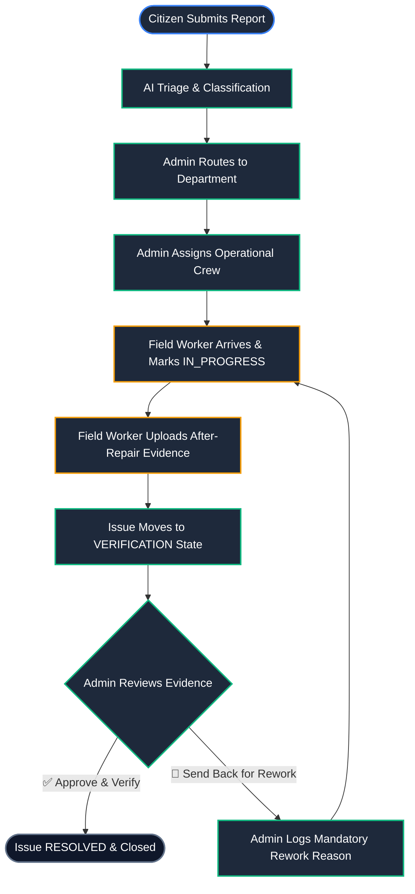
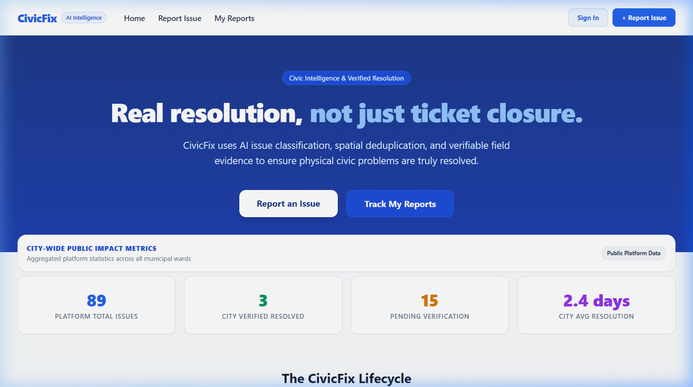
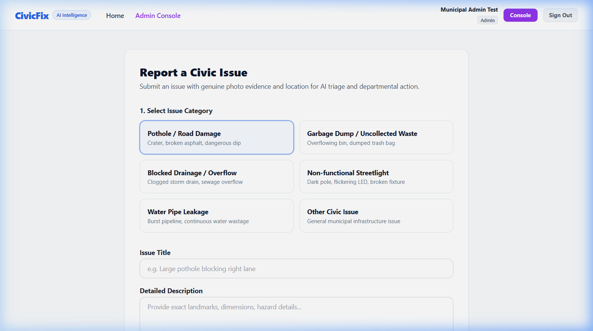
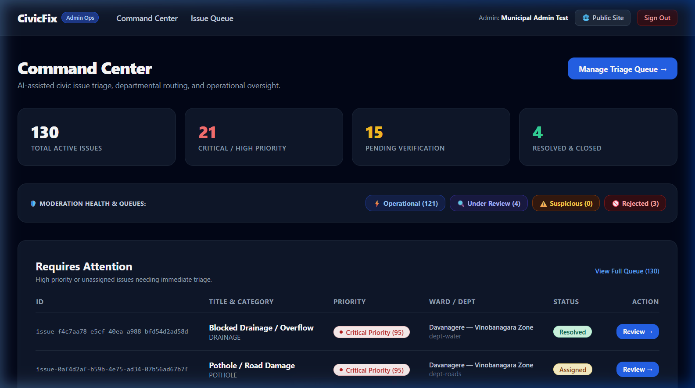
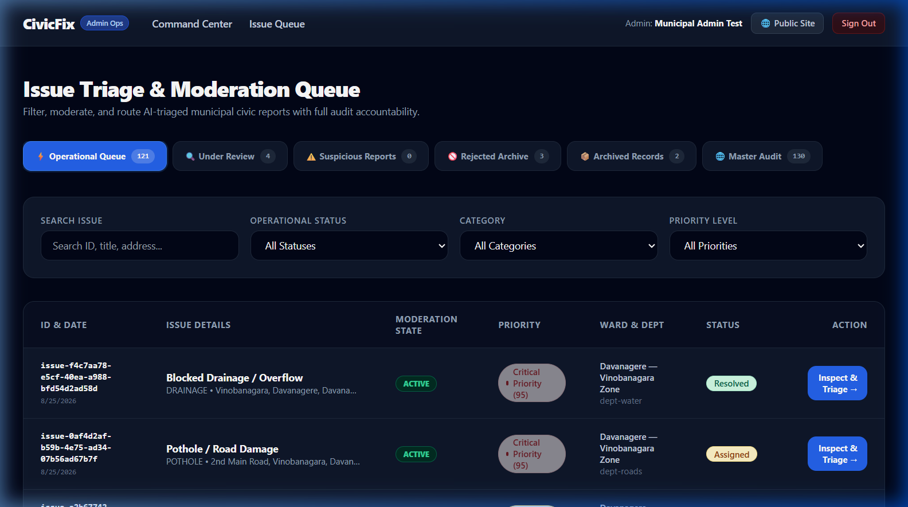
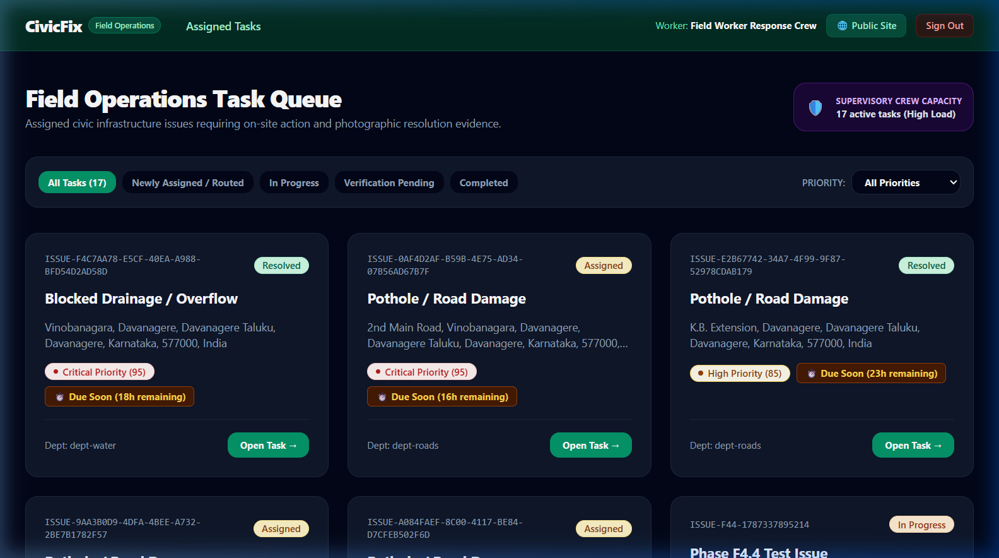
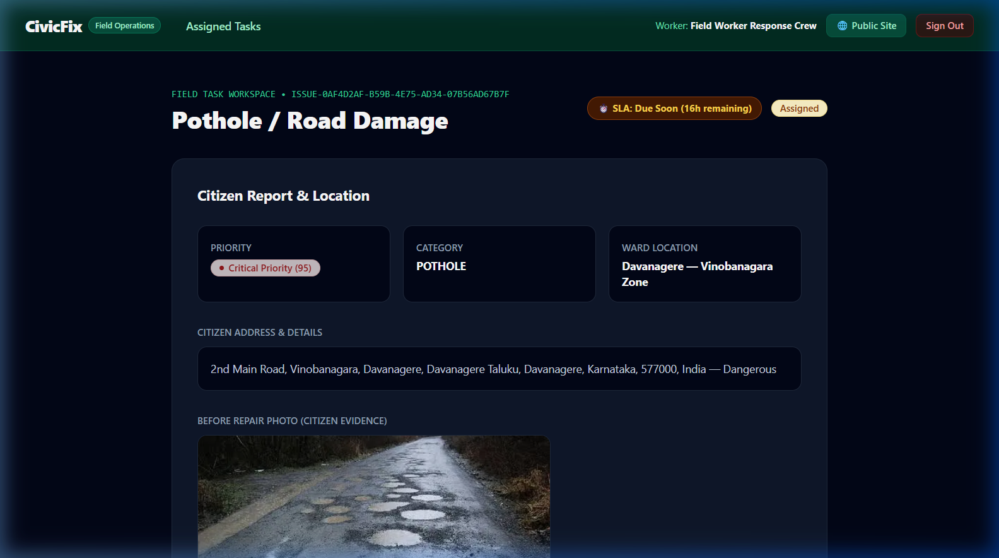
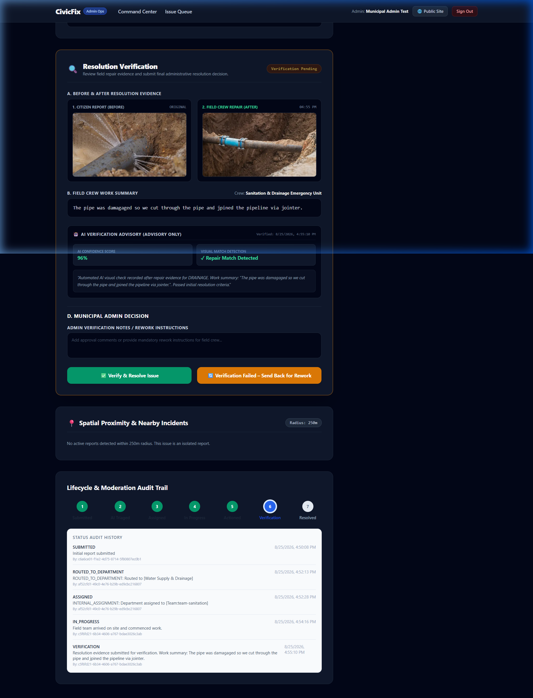
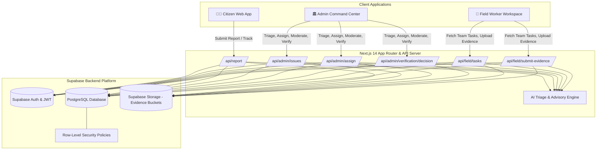

<div align="center">

# 🏙️ CivicFix ⚡

### Smart Civic Issue Reporting, Team-Based Field Operations & Transparent Resolution Management

*A unified platform connecting citizens 🧑‍💻, municipal administrators 🏛️, and field crews 👷 to resolve urban infrastructure issues with full transparency and end-to-end auditability.*

[](https://nextjs.org/)
[](https://www.typescriptlang.org/)
[](https://tailwindcss.com/)
[](https://supabase.com/)
[](https://www.postgresql.org/)
[](https://leafletjs.com/)

</div>

---

## 🎯 The Problem

Modern municipalities face critical breakdowns in public infrastructure maintenance:

* **Fragmented Communication:** Citizen complaints get lost across disparate phone hotlines, web forms, and departmental silos without tracking.
* **Triage Bottlenecks:** Municipal administrators struggle to prioritize urgent road hazards, electrical faults, or sanitation emergencies from duplicate or low-priority reports.
* **Worker Disconnect:** Field workers lack real-time digital task queues, GPS locations, and direct incident context.
* **Accountability Deficit:** Repairs are often closed without proof of work, leaving citizens skeptical and administrators unable to verify on-site execution.

---

## 💡 Our Solution

**CivicFix** creates an interconnected operational ecosystem across three distinct roles:

```text
[Citizen Report] ➔ [AI & Admin Triage] ➔ [Crew Assignment] ➔ [Field Work] ➔ [Resolution Evidence] ➔ [Admin Verification] ➔ [Resolved / Rework]
```

1. **🧑‍💻 Citizens** report issues with precise GPS coordinates, photographic evidence, and real-time lifecycle tracking.
2. **🏛️ Municipal Admins** triage reports with AI-assisted severity assessments, route issues to municipal departments, assign operational crews, moderate spam/duplicates, and review repair verification evidence.
3. **👷 Field Crews** receive dedicated team task queues, update live on-site progress, and upload after-repair visual evidence with work summaries.

---

## ✨ Product Highlights

### 👤 Citizen Portal
* **One-Click Incident Reporting:** Capture live device GPS coordinates or use an interactive Leaflet map pin with reverse geocoding.
* **Real-Time Lifecycle Tracking:** Transparent 7-step visual status stepper (*Submitted ➔ AI Triaged ➔ Assigned ➔ In Progress ➔ Actioned ➔ Verification ➔ Resolved*).
* **Community Feed & Public Dashboard:** Live public metrics on total reports, in-progress tasks, resolved repairs, and nearby incident clustering within 250m.

### 🏛️ Municipal Admin Command Center
* **Live KPI Dashboard:** High-level overview of SLA performance, active operational assignments, unassigned queues, and urgent priority cases.
* **Interactive Triage Queue:** Filter incidents by category, priority, status, and moderation state with deep inspection workspaces.
* **Department Routing & Team Assignment:** Route issues to appropriate municipal departments (*Roads & Transport, Water Supply & Drainage, Electricity & Power, Waste Management*) and assign to specialized operational crews.
* **Moderation Controls:** Separate moderation queue system (*Active, Under Review, Suspicious, Rejected, Archived*) with automated crew assignment deactivation upon archiving.

### 👷 Team-Based Field Operations
* **Team-Centric Task Queue:** Automatic queue distribution based on the field worker's operational team membership (*e.g., Sanitation & Drainage Emergency Unit, Road Maintenance Crew*).
* **On-Site Status Transitions:** Move tasks from `ASSIGNED` to `IN_PROGRESS` with a single tap upon arriving at the location.
* **Evidence Upload System:** Capture and upload after-repair photographic proof and structured work summaries directly to canonical cloud storage buckets.

### 🔍 Smart Triage & Moderation
* **AI Advisory Diagnostics:** Automated visual confidence analysis, urgency scoring, and recommended remediation workflows.
* **Spatial Proximity Detection:** Identifies nearby incidents within a 250m radius to eliminate duplicate dispatches and detect infrastructure clusters.

### 📸 Resolution Evidence & Final Admin Verification
* **Side-by-Side Evidence Comparison:** Municipal administrators review the original citizen photo alongside the field worker's after-repair evidence.
* **AI Visual Verification Advisory:** Advisory match detection and confidence rating comparing before and after conditions.
* **Decisive Administrative Controls:**
  * `✅ Verify & Resolve Issue`: Confirms repair quality, updates status to `RESOLVED`, records verifier UUID, and logs complete audit history.
  * `🔄 Verification Failed – Send Back for Rework`: Rejects insufficient repair evidence with mandatory feedback notes, returning the issue to `IN_PROGRESS` for field crew rework.

### 🛡️ Security & Role-Based Access Control (RBAC)
* **Server-Side Token Validation:** Strict Bearer token verification using Supabase Auth with server-side profile role enforcement (`MUNICIPAL_ADMIN`, `FIELD_WORKER`, `CITIZEN`).
* **Row-Level Security (RLS):** Database-level security policies guarding private reports, team task queues, and administrative operations.

---

## 🔄 Complete Operational Workflow



---

## 📸 Product Screenshots

### 🧑‍💻 Citizen Experience

| Public Landing & Tracking Feed | Interactive Report Submission |
| :---: | :---: |
|  |  |
| *Live civic KPI statistics, interactive issue tracker, and recent municipal activity feed.* | *GPS location picker, automated coordinate capture, category selection, and photo upload.* |

---

### 🏛️ Municipal Administration

| Admin Command Center & SLA Overview | Triage Queue & Department Routing |
| :---: | :---: |
|  |  |
| *High-level operational metrics, urgent issue alerts, and department activity counters.* | *Comprehensive incident filtering by status, priority, and moderation queues with inspection actions.* |

---

### 👷 Field Operations & Task Execution

| Field Worker Task Queue | Field Task Workspace & Action Controls |
| :---: | :---: |
|  |  |
| *Team-specific assigned tasks with SLA countdowns and incident severity badges.* | *Incident details, map location, on-site status toggle, and resolution evidence submission form.* |

---

### 🔍 Resolution Evidence & Verification Decision

<div align="center">



*Side-by-side Before/After photo comparison, Field Crew work summary, AI Verification Advisory (96% confidence score), and Municipal Admin verification decision actions.*

</div>

---

## 🏗️ System Architecture



---

## 👥 Role-Based Workflow Matrix

| Role | Primary Responsibilities | Workspace View | Available Actions |
| :--- | :--- | :--- | :--- |
| **`CITIZEN`** | Submits incident reports and monitors repair progress | `/`, `/report`, `/my-reports` | Submit reports with GPS/images, track status stepper, view public metrics |
| **`MUNICIPAL_ADMIN`** | Oversees municipal operations, routes reports, and verifies completed work | `/admin`, `/admin/issues`, `/admin/map` | AI triage, department routing, team assignment, moderation, verify & resolve, rework requests |
| **`FIELD_WORKER`** | Executes repairs assigned to their operational crew | `/field`, `/field/issues/[id]` | View team task queue, mark tasks `IN_PROGRESS`, upload after-repair evidence |

---

## 🛡️ Moderation vs Operational Lifecycle

CivicFix maintains a clear architectural boundary between **Operational Status** and **Moderation State**:

* **Operational Status** tracks the physical lifecycle of repair work:
  $$\text{SUBMITTED} \longrightarrow \text{ASSIGNED} \longrightarrow \text{IN\_PROGRESS} \longrightarrow \text{VERIFICATION} \longrightarrow \text{RESOLVED}$$
* **Moderation State** controls visibility, spam prevention, and queue participation:
  $$\text{ACTIVE} \quad\vert\quad \text{UNDER\_REVIEW} \quad\vert\quad \text{SUSPICIOUS} \quad\vert\quad \text{REJECTED} \quad\vert\quad \text{ARCHIVED}$$

> [!NOTE]
> A failed repair verification **never** changes moderation status to `REJECTED`. Moderation `REJECTED` is reserved for fraudulent citizen submissions. A failed repair verification returns the operational status to `IN_PROGRESS` for field crew rework.

---

## 🧰 Technology Stack

* **Frontend Framework:** Next.js 14 (App Router, Server & Client Components)
* **Language:** TypeScript 5.0 (Strict mode enabled)
* **Styling & Design System:** Tailwind CSS with custom slate/dark aesthetic and CSS grid systems
* **Database & Authentication:** Supabase PostgreSQL with Row Level Security (RLS) & Supabase Auth
* **Storage:** Supabase Storage (canonical `civicfix-reports` and `civicfix-evidence` buckets)
* **Mapping & GIS:** Leaflet & OpenStreetMap for browser-based interactive location mapping
* **AI & Validation:** Integrated advisory heuristic triage engine and before/after verification scoring

---

## 🚀 Getting Started

### Prerequisites
* Node.js 18.17+ or 20+
* npm or yarn
* Supabase Account & Project

### 1. Clone the Repository
```bash
git clone https://github.com/Zyphron01/CivicFix.git
cd CivicFix
```

### 2. Install Dependencies
```bash
npm install
```

### 3. Environment Setup
Create a `.env.local` file in the root directory:
```env
NEXT_PUBLIC_SUPABASE_URL=https://your-project-id.supabase.co
NEXT_PUBLIC_SUPABASE_ANON_KEY=your-anon-key
SUPABASE_SERVICE_ROLE_KEY=your-service-role-key
```

### 4. Run Development Server
```bash
npm run dev
```
Open [http://localhost:3000](http://localhost:3000) in your browser.

### 5. Build for Production
```bash
npm run build
npm run start
```

---

## 📁 Project Structure

```text
CivicFix/
├── public/
│   └── screenshots/              # Real product demonstration screenshots
├── scripts/                      # Forensic automated integration test suites
│   ├── verify-admin-resolution-workflow.ts
│   ├── verify-field-worker-buttons-real-runtime.ts
│   └── test-phase-field-worker-team-assignment.ts
├── src/
│   ├── app/                      # Next.js 14 App Router routes & API endpoints
│   │   ├── admin/                # Municipal Admin workspace (/admin, /admin/issues)
│   │   ├── api/                  # Secure backend routes (/api/admin, /api/field)
│   │   ├── field/                # Field Worker workspace (/field, /field/issues)
│   │   ├── report/               # Citizen report submission page (/report)
│   │   └── login/                # Role-aware authentication page
│   ├── components/               # Reusable UI widgets, badges, timelines, maps
│   ├── context/                  # Authentication & global application state
│   ├── lib/                      # Supabase Admin clients & moderation helpers
│   ├── services/                 # Civic issue services & location utilities
│   └── types/                    # TypeScript interfaces for issues, teams, triage
└── supabase/
    └── migrations/               # PostgreSQL schema definitions & RLS policies
```

---

## 🧪 Testing & Verification

CivicFix includes automated end-to-end integration test suites:

* **Admin Resolution & Verification Suite:** [`scripts/verify-admin-resolution-workflow.ts`](./scripts/verify-admin-resolution-workflow.ts)
  * Tests evidence creation, admin approval, status history audit entries, rework loops, and security authorization matrix.
* **Field Worker Action Buttons Suite:** [`scripts/verify-field-worker-buttons-real-runtime.ts`](./scripts/verify-field-worker-buttons-real-runtime.ts)
  * Validates on-site status toggles, evidence image uploads, and live status propagation.
* **Team-Based Assignment Suite:** [`scripts/test-phase-field-worker-team-assignment.ts`](./scripts/test-phase-field-worker-team-assignment.ts)
  * Validates department routing, team queue filtering, and role-based access enforcement.

To run tests:
```bash
npx tsx scripts/verify-admin-resolution-workflow.ts
```

---

## 🔮 Future Scope

* **Mobile Field App (PWA / React Native):** Offline mode with background sync for remote field crews with weak cellular connectivity.
* **Predictive Asset Maintenance:** Machine learning forecasting to predict recurring road damage and water pipe bursts before failure.
* **Citizen Upvoting & Crowdsourced Verification:** Allow nearby verified residents to confirm repair quality in public spaces.
* **Multi-Language Voice Reports:** Speech-to-text report filing in local regional dialects for enhanced accessibility.

---

## 🏆 Built For

**CivicFix** was designed and engineered as a modern, transparent, and high-impact GovTech solution to transform municipal public works management through accountable digital workflows.

<div align="center">

Made with ❤️ by Zyphron01 for resilient and responsive cities.

</div>